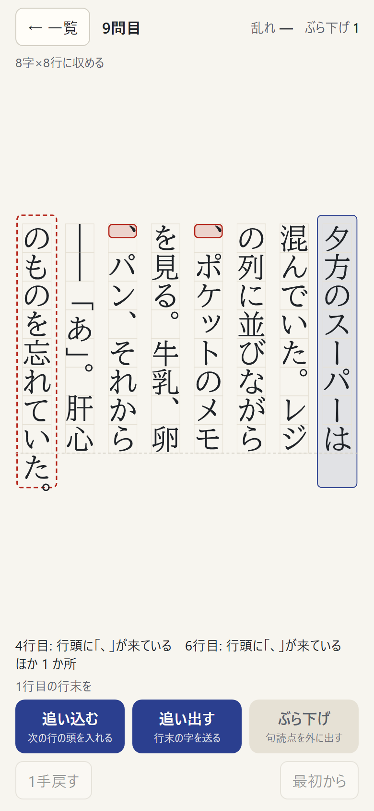
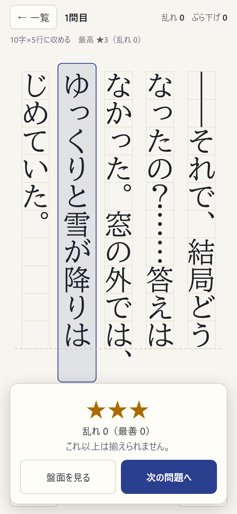
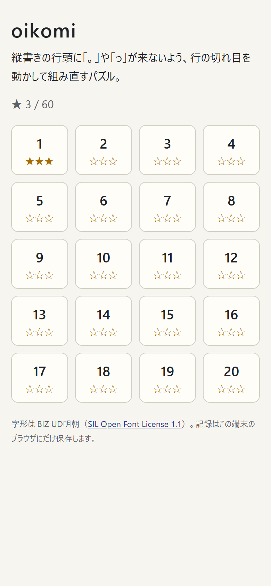

# oikomi

縦書きの段で、行頭に「。」「、」「っ」、行末に「「」が来ないよう、行の切れ目を **追い込む・追い出す・ぶら下げる** の3つの操作で組み直すパズル。
直したあとの字間の揃い具合（乱れ）を、すべての組み方を調べて求めた最善と比べて ★1〜3 を付ける。1問1〜3分、全20問。

**アプリ:** （公開後に URL を書く）（スマホ・PC のブラウザで、開くだけで遊べる）



本文はすべて書き下ろし。字形は BIZ UD明朝の縦書き用の字形を、問題に出てくる字だけ取り出して SVG で描く。
組版の規則は、同じ作者の縦書き組版ツール [kumi](https://github.com/tame0522works-art/kumi) の組版エンジン（W3C「日本語組版処理の要件」JLREQ に基づく）から持ってきた。
公開版は Content Security Policy で通信（fetch など）をすべて禁じていて、記録はその端末のブラウザにだけ残る。

## 遊び方

| 完成したところ | 一覧 |
|---|---|
|  |  |

- 盤面は、問題で決まった **字詰め×行数**（例: 10字×5行）。行数は変えられない
- 行をタップして選び、その行の行末を動かす
  - **追い込む**: 次の行の頭の1字をこの行に入れる。字詰めを超えた分は、約物（括弧・読点など）の空きを縮めて収める
  - **追い出す**: この行の最後の1字を次の行へ送る。足りなくなった分は字間に配る
  - **ぶら下げ**: 次の行の頭の句点・読点を、この行の字詰めの外に出す。使える回数は問題ごとに決まっている
- 禁則に触れている字は赤く光り、画面の下に「4行目: 行頭に「、」が来ている」のように出る
- 禁則がなくなると完成。そのときの乱れが最善と同じなら ★3、近ければ ★2、それ以外は ★1。完成したあとも続けて揃え直せる

## 作りの要点

### 行の評価と乱れ

[`src/engine/line.ts`](src/engine/line.ts)。行の切れ目を決めたら、その行がどう組まれるかを出す。

| 見ること | 内容 |
|---|---|
| 行頭禁則 | 終わり括弧・句読点・中点・？！・小書きの仮名・長音記号・繰返し記号（小書きと長音も禁じる強い禁則） |
| 行末禁則 | 始め括弧 |
| 分離禁止 | ―― と …… は2字で1組なので、間で改行しない |
| 長すぎる行 | 約物の空き（二分）を縮めて収める。句点の後ろは縮めない。縮めても入らなければ違反 |
| 短い行 | 足りない分を字間に均等に配る。最後の行は配らない（行頭そろえ） |

乱れは行ごとに足す。字間に配った量を1か所あたり x（全角 = 1）とすると 100x²、約物の空きを縮めた長さを y とすると 10y²。
字間が全角の1/10ずつ空くと1、二分縮めると2.5で、JLREQ が追い出しより追い込みを先に試すのに合わせて、縮めるほうを軽くした。画面では10倍した整数で見せる。

### 最善の解

[`src/engine/solve.ts`](src/engine/solve.ts)。行の乱れは行の中だけで決まるので、「r 行目を位置 s から始め、ぶら下げを h 回使ったときの残りの最小の乱れ」の動的計画法で、すべての組み方を調べる。
同じ乱れになる組み方の数も数える。★3 の基準はこの最善。

比べるために、組版ソフトと同じく **頭から1行ずつ「ぶら下げ → 追い込み → 追い出し」の順で直す解** も作る（kumi の行分割と同じ順）。
この解が行数に合わなかったり乱れが大きかったりする問題は、先の行まで見て切れ目を決めないと ★3 が取れない。後半の問題はそうなるように選んだ。

### 問題の作り方

本文を書き、[`tools/scan.ts`](tools/scan.ts) で字詰め8〜12・行数・ぶら下げの回数を振って、最初の盤面（字数で切っただけ）に違反があり、頭から直すと最善にならない組み合わせを探した。
分かったのは、行数を自然な組み方より1行多くすると「頭から直すと最善にならない」問題になりやすいこと。字詰めを詰めて行数を減らす方向では、頭から直す解もたいてい最善にたどり着く。

### 字形

[`tools/glyphs.ts`](tools/glyphs.ts) が、BIZ UD明朝から問題に出てくる字（258字）だけを、縦書き用の字形（GSUB の vert）に置き換えて SVG の path にし、[`src/glyphs.json`](src/glyphs.json) に書き出す（270KB、gzip でアプリ全体 160KB）。
フォント全体（6MB）を配らずに済み、端末のフォントに左右されずに句読点・括弧の位置まで揃う。字形の読み取り（TrueType の glyf と GSUB）は kumi のものを使っている。
字は本文での位置を key にしているので、切れ目を動かすと隣の行へ滑って移る。

## 確かめ方

| コマンド | 確かめること |
|---|---|
| `npm run check:engine` | 手で答えの分かる例で、禁則・追い込み・字間の配り・ぶら下げ・3つの操作・最善解・★ |
| `npm run check:puzzles` | 20問すべてで、解けること、最初の盤面に違反があること、最善解が画面の操作だけで作れること（その手順を作って当てはめる）、字形データに漏れがないこと。難しさの目安も一覧にする |
| `npm run e2e` | 公開と同じビルドを画面なしの Chrome で開き、本物のマウス・タッチで操作する（8件）。スマホの指で1問目を ★3 まで解く、記録は良いときだけ書き換える、20問目を最善解の手順で解いて乱れが最善と一致する、保存できないブラウザでも遊べる、CSP で通信が止まる |

## 扱っていないこと

- ルビ・縦中横・欧文。問題の本文に使わないので、組版エンジンから外した（`check:puzzles` が半角の字を弾く）
- 段落の字下げ・複数の段落。1問は1段落で、字下げなしで始まる
- キーボードでの操作
- 自分で本文を入れて遊ぶこと

## フォント

字形は [BIZ UD明朝](https://github.com/googlefonts/morisawa-biz-ud-mincho)（Copyright 2022 The BIZ UDMincho Project Authors）から取り出したもので、[SIL Open Font License 1.1](public/OFL.txt) に従う。公開版にも `OFL.txt` を同梱し、一覧の下からリンクしている。

## 開発

```bash
npm install
npm run dev       # http://localhost:5209/
npm run check     # check:engine と check:puzzles
npm run e2e       # 画面操作のテスト
npm run glyphs    # 問題の字を足したら字形データを作り直す（../kumi/fonts の BIZ UD明朝を使う。FONT で別の場所も指定できる）
npx tsx tools/scan.ts "本文"           # 問題づくりの下調べ
npx tsx tools/design.ts 10 "本文"      # 字詰めを決めて、行数・ぶら下げごとの最善を見る（SHOW=1 で盤面も出す）
npm run build && npm run preview       # 公開版を http://localhost:5210/ で確かめる
npm run screenshots                    # 公開版から docs/images/ の画像を撮る
```
